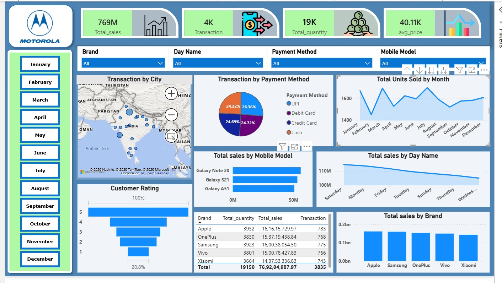

# Motorola Mobile Sales Dashboard

An interactive Power BI dashboard analyzing mobile phone sales across brands, models, cities, payment methods, months and weekdays, along with customer ratings.



## Project Objectives & Analytical Scope

- **Sales Performance KPIs:** Tracking total sales, transactions, total quantity sold and average price.
- **Brand & Model Analysis:** Comparing sales and quantity across brands (Apple, Samsung, OnePlus, Vivo, Xiaomi) and Samsung Galaxy models.
- **Time-Based Trends:** Monthly units sold and day-of-week sales patterns.
- **Payment Behavior:** Distribution of transactions across UPI, Debit Card, Credit Card and Cash.
- **Geographic Distribution:** Transaction spread across cities in India using a map visual.
- **Customer Satisfaction:** Rating distribution (1-5) shown as a funnel chart.

## Dashboard Components

| Visual | Type | Purpose |
|---|---|---|
| Total_sales, Transaction, Total_quantity, avg_price | KPI cards | Headline business metrics |
| Brand / Day Name / Payment Method / Mobile Model | Slicers (dropdown) | Interactive filtering |
| Month selector (January - December) | Slicer (buttons) | Filter by month |
| Transaction by City | Map | Geographic spread of transactions |
| Transaction by Payment Method | Pie chart | Payment mode share |
| Total Units Sold by Month | Area/line chart | Monthly demand trend |
| Total sales by Mobile Model | Bar chart | Model-level revenue |
| Total sales by Day Name | Area chart | Weekday sales pattern |
| Customer Rating | Funnel chart | Rating distribution |
| Brand summary | Table | Quantity, sales and transactions by brand |
| Total sales by Brand | Column chart | Brand revenue comparison |

## Key Metrics Snapshot

| Metric | Value |
|---|---|
| Total Sales | 76,92,04,987.97 (~769M) |
| Transactions | 3,835 |
| Total Quantity | 19,150 |
| Average Price | ~40.11K |

## Tools & Technologies

- **Microsoft Power BI Desktop**: data modeling, DAX measures, visuals
- **Microsoft Excel**: source dataset
- **DAX**: calculated measures (see [DAX_Measures.md](DAX_Measures.md))

## Project Structure

```
Motorola_Dashboard/
├── Dashboard.jpeg                 # Dashboard screenshot
├── Day - 30 - Mobile Sales Data.xlsx   # Source dataset
├── practice dashboard.pbit        # Power BI template file
├── DAX_Measures.md                # Measures used in the report
├── Data_Dictionary.md             # Column descriptions
├── .gitignore
├── LICENSE
└── README.md
```
